# Oneliner

**One logline in, a stitched movie trailer out.**

#OpenSourceHiggsfield

- **Live app:** https://oneliner-thaohienhomes-gmailcoms-projects.vercel.app
- **Example trailer (share page):** https://oneliner-thaohienhomes-gmailcoms-projects.vercel.app/t/0pfhukuh2e
- **Demo video:** coming soon

<!-- HERO: add a GIF/MP4 of the app here, e.g.  -->

## What it is

You type one sentence. Oneliner writes a shot list for it, renders every shot as a video clip on Comfy Cloud, stitches the clips and a title card into one MP4 in your browser, and publishes it to a share page you can send to anyone.

The example trailer above is 14 s long. Clips render at 768x448 (16:9) or 448x768 (9:16).

## How it works

```mermaid
flowchart LR
    A["Logline (one sentence)"] --> B["Groq LLM: shot list (JSON)"]
    B --> C["Shot editor: tweak shots, aspect, duration"]
    C --> D["Comfy Cloud: Z-Image Turbo, first frame"]
    D --> E["Comfy Cloud: LTX-2.3 image-to-video clip"]
    E --> F["Re-host clip: Vercel Blob or local disk"]
    F --> G["Browser: ffmpeg.wasm stitches clips + title card"]
    G --> H["Publish: Vercel Blob"]
    H --> I["Share page /t/id"]
```



1. **Logline to shot list (about 1.5 s).** `POST /api/shotlist` sends the logline to an OpenAI-compatible Chat Completions endpoint in JSON mode (`lib/llm.ts`). Default is Groq with `openai/gpt-oss-120b`; if it errors, times out (about 20 s budget per model) or returns invalid JSON twice, it retries with the fallback model `qwen/qwen3.8-27b`. If both fail, or no key is set, or `LLM_MOCK=1`, a deterministic mock shot list answers, so the editor never dead-ends. The result is 4 to 6 shots of 2 to 4 whole seconds each (`lib/renderConfig.ts`).
2. **First frame: Z-Image (Turbo) text-to-image.** For each shot, `POST /api/shot` patches `workflows/zimage_t2i_api.json` (prompt, seed, width, height) and submits it to Comfy Cloud, then waits for the PNG.
3. **Animation: LTX-2.3 image-to-video.** The same request binds that PNG to the `LoadImage` node of `workflows/ltx23_i2v_api.json`, sets prompt, negative prompt, seeds, size and duration, and submits the video job. The browser then polls `GET /api/shot/{jobId}` until the clip is done. At most 3 render jobs run at once per editor (`lib/limiter.ts`). The LTX-2.3 workflow also generates an audio track.
   - **LTX-2.5 text-to-video** (`workflows/ltx25_t2v_api.json`) is **included as an alternative workflow only**. The app does not load or submit it; every render goes through Z-Image then LTX-2.3. (The LTX-2.3 workflow has its own built-in "Switch to Text to Video?" toggle; the app always sets it to `false`.)
4. **Stitch in the browser.** `src/lib/browserStitch.ts` loads ffmpeg.wasm (single-threaded core, no special headers), draws a title card (title + tagline) on a canvas, and builds one filter graph (`lib/stitchPlan.ts`): every clip is normalised to the same size/fps, held or trimmed to its exact length, joined with 6-frame crossfades, then an optional 1 s cold-open title and a 2 s end title card. Clip audio is kept only if every clip has audio. You can preview and download the MP4.
5. **Publish and share.** `POST /api/publish` uploads the MP4, a JPEG poster and a `{id}.json` metadata file to Vercel Blob (or local disk without a Blob token) under a short random id. `/t/<id>` shows the player, the director's notes (shots and prompts), Download, Copy link, share-intent buttons for X / Reddit / LinkedIn (nothing is posted automatically), and `og:video` / `og:image` tags. The home page shows a gallery of recent trailers.

Measured on the hosted app: a 4-shot trailer takes about 2 minutes to render.

## Built on the Comfy Developer Platform

Oneliner talks to Comfy only from the server, through the official TypeScript SDK **`@comfyorg/sdk`** (v0.5.0).

**Client and auth** (`lib/comfy.ts`)

- One shared `new Comfy({ apiKey, clientInfo: "oneliner" })`.
- Target: `COMFY_BASE_URL`, or Comfy Cloud **https://cloud.comfy.org** when it is blank. The SDK appends `/api/v2/...` to that base URL.
- Auth: `COMFY_API_KEY`, sent by the SDK as `Authorization: Bearer <key>`. The key is never logged or sent to the browser.

**Calls the app makes** (`lib/renderShot.ts`, `lib/rehost.ts`), and the Comfy API v2 endpoints the SDK uses for them:

| Step | SDK call | Endpoint |
| --- | --- | --- |
| Load + patch a workflow | `client.workflows.fromJson(json)`, `wf.setInput(nodeId, input, value)` | local, no request |
| Submit a job (T2I or I2V) | `client.submit(wf)` | `POST /api/v2/jobs` |
| Job status (polled by the browser via `GET /api/shot/{jobId}`) | `client.jobs.get(id)` | `GET /api/v2/jobs/{id}` |
| Wait for the first frame | `job.wait(timeoutMs)` | polls `GET /api/v2/jobs/{id}` with backoff |
| Re-use the first frame as an input | `client.assets.get(assetId)` | `GET /api/v2/assets/{id}` |
| Signed download URL for an output | `output.getDownloadUrl()` | `GET /api/v2/assets/{id}/content` (redirect not followed) |
| Download clip bytes for re-hosting | `output.toBytes()` | `GET /api/v2/assets/{id}/content` |

**First frame to `LoadImage`.** The Z-Image output is already a Comfy asset, so nothing is re-uploaded: the app takes the output's asset id, rehydrates it with `client.assets.get(id)`, and sets that asset handle as the `image` input of `LoadImage` (node `269`). The SDK replaces it with an asset reference when the job is submitted.

**Re-hosting outputs.** Comfy output URLs are signed and expire (the job status carries `outputExpiresAt`). After a clip finishes, the editor calls `POST /api/shot/{jobId}/rehost`, which downloads the clip bytes and stores them as `renders/{jobId}.mp4` on Vercel Blob (or `public/renders/` locally). The stitcher and the share page only use these re-hosted copies.

**Quirk: SaveVideo outputs are labelled `type: "image"`.** Comfy Cloud reports the LTX `SaveVideo` mp4 with `type: "image"` (content type `video/mp4`), so `type` cannot be trusted. `lib/outputs.ts` picks the video by content type `video/*` first, then a `.mp4/.webm/.mov/.mkv` file name, then `type === "video"`, preferring outputs of the `SaveVideo` node. Still frames are picked as `type === "image"` that are not video.

**Errors.** SDK errors (401, 403, 402 insufficient credits, job failed, invalid workflow, timeout, ...) are mapped to short friendly messages for the browser; raw SDK messages stay in the server log.

**Model files referenced inside each workflow**

| Workflow | Model files |
| --- | --- |
| `zimage_t2i_api.json` | `z_image_turbo_bf16.safetensors`, `qwen_3_4b.safetensors`, `ae.safetensors` |
| `ltx23_i2v_api.json` | `ltx-2.3-22b-dev-fp8.safetensors`, `ltx_2.3_22b_distilled_1.1_lora_dynamic_fro09_avg_rank_111_bf16.safetensors`, `ltx-2.3-spatial-upscaler-x2-1.1.safetensors`, `gemma_3_12B_it_fp4_mixed.safetensors`, `gemma-3-12b-it-abliterated_lora_rank64_bf16.safetensors` |
| `ltx25_t2v_api.json` | `ltx-2.5-22b-distilled-transformer-comfy-int8-convrot.safetensors`, `ltx-2.5-video-vae-bf16.safetensors`, `ltx-2.5-audio-vae-bf16.safetensors`, `ltx-2.5-latent-spatial-upscaler-x2-bf16-1.0.safetensors`, `gemma4-12b-with-proj-ltx-2.5-comfy-int8-convrot.safetensors`, `gemma4_e2b_it_int8_convrot.safetensors` |

## Workflows

All workflows are in [`workflows/`](./workflows). They were exported from ComfyUI with **File -> Export Workflow (API)**. To inspect one, open ComfyUI and use **File -> Open**, or drag the JSON onto the canvas.

| File | What it does | Used by the app |
| --- | --- | --- |
| `zimage_t2i_api.json` | Z-Image Turbo text-to-image (8 steps, cfg 1): the first frame of each shot | Yes, step 1 of every shot |
| `ltx23_i2v_api.json` | LTX-2.3 image-to-video with generated audio: renders at half size, then x2 latent upscale | Yes, step 2 of every shot |
| `ltx25_t2v_api.json` | LTX-2.5 text-to-video (no first frame needed) | No, included as an alternative workflow |

**Node inputs the app patches** (`lib/workflowMap.ts`). Before submitting, `lib/renderShot.ts` checks that every node id exists and has the expected `class_type`, so a re-exported workflow with changed ids fails loudly instead of rendering the wrong thing.

| Workflow | Node id | Class | Input | Set to |
| --- | --- | --- | --- | --- |
| Z-Image T2I | `57:27` | CLIPTextEncode | `text` | shot prompt |
| Z-Image T2I | `57:3` | KSampler | `seed` | seed |
| Z-Image T2I | `57:13` | EmptySD3LatentImage | `width`, `height` | render size |
| Z-Image T2I | `9` | SaveImage | `filename_prefix` | `oneliner/frame` |
| LTX-2.3 I2V | `269` | LoadImage | `image` | first-frame asset |
| LTX-2.3 I2V | `320:319` | PrimitiveStringMultiline | `value` | shot prompt |
| LTX-2.3 I2V | `320:313` | CLIPTextEncode | `text` | negative prompt (if given) |
| LTX-2.3 I2V | `320:277`, `320:276` | RandomNoise | `noise_seed` | seed, seed + 1 |
| LTX-2.3 I2V | `320:312`, `320:299` | PrimitiveInt | `value` | width, height (multiples of 64) |
| LTX-2.3 I2V | `320:301` | PrimitiveInt | `value` | duration in whole seconds |
| LTX-2.3 I2V | `320:302` | PrimitiveBoolean | `value` | `false` (image-to-video) |
| LTX-2.3 I2V | `320:328` | PrimitiveBoolean | `value` | `false` (prompt enhance off) |
| LTX-2.3 I2V | `75` | SaveVideo | `filename_prefix` | `oneliner/shot` |

Z-Image Turbo has no negative prompt input (its negative is a zeroed conditioning). The LTX frame count is derived inside the graph as Duration x 25 fps + 1.

## Run locally

Works on Windows, macOS and Linux.

**Prerequisites**

- Node.js 20+ and Git
- A Comfy account with API access and an API key. Per [docs.comfy.org](https://docs.comfy.org), the Comfy Cloud API needs a paid Cloud tier.
- An LLM key: Groq, or any OpenAI-compatible server (`LLM_BASE_URL`)
- Optional: a Vercel Blob token (without it, clips and trailers are saved to local disk)

**Steps**

```bash
git clone https://github.com/thaohienhomes/oneliner
cd oneliner
npm install
cp .env.example .env.local        # Windows cmd: copy .env.example .env.local
# fill in your own keys in .env.local
npm run dev
```

Open http://localhost:3000.

**Try it without any keys or credits.** With no LLM key the deterministic mock shot list is used, and with `DEMO_MODE=1` the "render" step plays the sample clips in `public/samples/` instead of calling Comfy. Stitching and publishing still run for real (locally).

**Optional: your own GPU.** Run ComfyUI locally with the comfy-api-proxy and set `COMFY_BASE_URL=http://127.0.0.1:8189`; the same SDK calls go to your machine instead of Comfy Cloud. See https://docs.comfy.org/api-reference/v2/overview. You need the model files listed above in your ComfyUI install.

**Tests**

```bash
npm test          # vitest unit + editor tests, no network
npm run lint
npm run typecheck
```

## Environment variables

Every variable in [`.env.example`](./.env.example), in the same order:

| Variable | Default | Meaning |
| --- | --- | --- |
| `COMFY_API_KEY` | blank | Comfy API key (Bearer token). Required for Comfy Cloud. |
| `COMFY_BASE_URL` | blank = `https://cloud.comfy.org` | Comfy API base URL; set to a local comfy-api-proxy to use your own GPU. |
| `GROQ_API_KEY` | blank | Groq key, used if `LLM_API_KEY` is blank. |
| `LLM_API_KEY` | blank | Key for the OpenAI-compatible LLM endpoint. No key = mock shot list. |
| `LLM_BASE_URL` | blank = `https://api.groq.com/openai/v1` | Chat Completions base URL. |
| `LLM_MODEL` | blank = `openai/gpt-oss-120b` | Primary shot-list model. |
| `LLM_FALLBACK_MODEL` | blank = `qwen/qwen3.8-27b` | Tried if the primary errors, times out (~20 s) or returns bad JSON twice. `none` = no fallback. If both fail, the mock answers. |
| `LLM_MOCK` | blank | `1` = always use the deterministic mock shot list. |
| `BLOB_READ_WRITE_TOKEN` | blank = local disk | Vercel Blob for re-hosted clips and published trailers. Blank = `public/renders/` and `public/trailers/`. |
| `NEXT_PUBLIC_SITE_URL` | blank = request host | Public origin for share links and `og:video` / `og:image`. |
| `DAILY_RENDER_LIMIT` | `20` | Shots per IP per UTC day. |
| `GLOBAL_DAILY_SHOTS` | `300` | Shots site-wide per UTC day. |
| `DATABASE_URL` | blank | Neon Postgres connection string for the daily budget counters (`usage` table, see Cost guards). Takes priority over Upstash. |
| `UPSTASH_REDIS_REST_URL` | blank = in-memory | Upstash Redis REST URL for shared budget counters across instances. |
| `UPSTASH_REDIS_REST_TOKEN` | blank | Upstash Redis REST token. |
| `DEMO_MODE` | blank | `1` = play pre-rendered sample clips instead of calling Comfy. |

## Cost guards

Every Comfy render costs credits, so `POST /api/shot` runs these checks in order, and a refused request never reaches Comfy:

1. **Server-side validation** (`lib/shotRequest.ts`). Rejects, never clamps: durations outside 2 to 4 whole seconds, more than 6 shots per trailer, sizes above 768 on either side or above 768x448 pixels in total, prompts over 1200 characters.
2. **Content filter** (`lib/contentFilter.ts`): a small PG-13 blocklist on the prompt.
3. **`DEMO_MODE=1`**: returns sample clips, no Comfy call, no credits, no budget used.
4. **Daily budget** (`lib/quota.ts`), checked before any Comfy call. Each shot counts against `DAILY_RENDER_LIMIT` (shots per IP per UTC day) and `GLOBAL_DAILY_SHOTS` (site-wide shots per UTC day). Over budget the API answers 429 "Daily studio budget used"; if the counter store is unreachable it answers 503 and nothing renders. The counter store is picked in this order:
   - **Neon Postgres**, when `DATABASE_URL` is set (`@neondatabase/serverless` over HTTP, no pool). One atomic SQL statement per shot reads the per-IP row and the site-wide row (`ip = '__global__'`) for the UTC day, and increments both only if both stay within their limits; `INSERT ... ON CONFLICT DO UPDATE ... WHERE` rechecks each limit on the locked row, so concurrent requests can't overshoot. If a concurrent request fills one row in between, the statement can write just one row; that increment is undone right away and the request is denied. IPs are never stored: the `ip` column holds a salted SHA-256 hash (salt derived from `DATABASE_URL`). Table (`db/schema.sql`, create it once yourself):
     ```sql
     CREATE TABLE usage (ip text, day date, shots int DEFAULT 0, PRIMARY KEY (ip, day));
     ```
     Operator check: `npx tsx --env-file=.env.local scripts/counter-selftest.ts` writes to the fake day 2000-01-01 only (expects ok, ok, denied) and leaves its rows for you to inspect and delete.
   - **Upstash Redis**, when `UPSTASH_REDIS_REST_URL` / `UPSTASH_REDIS_REST_TOKEN` are set.
   - **In-memory** per process otherwise (local dev; resets on restart).

The hosted demo runs with **12 shots per IP and 20 shots site-wide per day**, counted in Neon Postgres.

**Content policy.** The shot-list system prompt requires original characters only (no real people, celebrities, brands or copyrighted franchises) and PG-13 content. A deterministic IP guard (`lib/ipGuard.ts`) also swaps well-known real people, brands and franchise characters for original stand-ins, on the logline before any model sees it, on the generated shot list, and again on published titles and text.

## Other tools

The contest rules ask to explain non-Comfy tools:

- **Groq** (OpenAI-compatible Chat Completions): writes the shot list. Swappable for any OpenAI-compatible server via `LLM_BASE_URL`.
- **ffmpeg.wasm**: stitches the trailer in the user's browser, so no video encoding runs on our server.
- **Vercel Blob**: stores re-hosted clips and published trailers (MP4, poster, metadata).
- **Vercel**: hosts the app.
- **Next.js** (App Router, TypeScript), Tailwind CSS, zustand, zod.

## Credits

- **Z-Image (Turbo)** by Tongyi-MAI (Alibaba): first frames.
- **LTX-2.3 / LTX-2.5** by Lightricks: image-to-video and text-to-video. https://github.com/Lightricks/LTX-Video
- **gpt-oss-120b** (OpenAI open-weight model) and **Qwen**, served by Groq: shot lists.
- **ComfyUI** and **Comfy Org** (Comfy Cloud, `@comfyorg/sdk`). https://github.com/comfyanonymous/ComfyUI

## License

[MIT](./LICENSE), (c) 2026 Vip Tom. See [LICENSE](./LICENSE).
